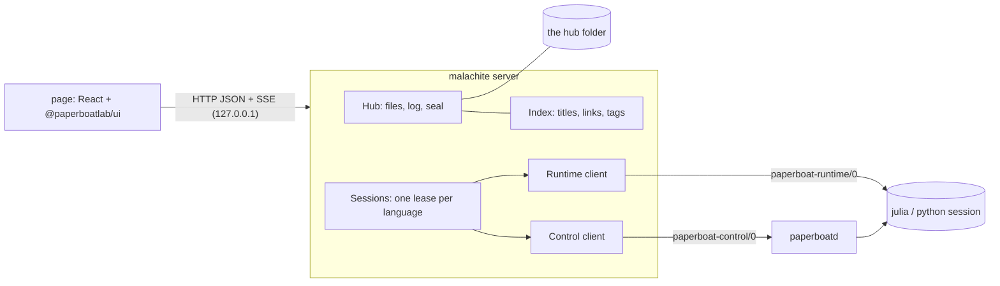

# Architecture

The plan and the decisions the spec left open: `plans/2026-11-24_21-50_malachite_v0_1.md` in the
workspace (pb#415). This page is the map.

## 1. Overview

Malachite is an app server and a page. The server owns the hub (a folder) and speaks two protocols of
the platform: `paperboat-control/0` to `paperboatd` for leases, and `paperboat-runtime/0` to the
session runtimes the leases start. The page is a client of the server only.

## 2. Codemap

- `server/note.ts`: a note's parts: front matter (a YAML subset), title, tags, `[[links]]`, cells and
  their hashes. Pure functions.
- `server/hub.ts`: `Hub`: every path through `resolve` (inside the hub, symlinks too), the tree,
  read/write (atomic), create (id, time, author set here), move, trash (`.malachite/trash`), seal, and
  the activity log (`log/YYYY-MM.jsonl`).
- `server/index.ts`: `Index`: built from the files at start, updated by `fs.watch`; link resolution
  (path, name, the nearest of several), backlinks with their line.
- `server/control.ts`: `Control`: one connection to `paperboatd` (started on demand, as the CLI does);
  leases belong to it, so closing it releases them.
- `server/runtime.ts`: `Runtime`: the framed client of a runtime's socket; requests in order, `stream`
  and `display` notifications by request id.
- `server/sessions.ts`: `Sessions`: one session lease per language for the hub; cells queue per
  language, run in their note's folder, and their outputs are written to
  `.malachite/out/<note id>/<cell hash>.json` with the runtime, image digest and backend that made them.
  Interrupt goes through the daemon (SIGINT); no answer within 3 s restarts the session.
- `server/main.ts`: the HTTP server: the page from `dist/`, the JSON API, Server-Sent Events.
- `client/`: `App.tsx` (the shell: bar, rail, cards, tabs, search, dialogs; files that aren't notes, a CSV
  plotted), `Note.tsx` (properties, the Read view, cells and outputs), `fileMenu.ts` (the brand file menu
  for the kit's tree), `Graph.tsx` (the hub graph and the local graph, the kit's note graph), `Side.tsx` (the Links card, the
  runtimes key and its peek), `markdown.ts` (marked with wikilinks and embeds), `files.tsx`, `api.ts`.
- **From the kit** (`@paperboatlab/ui`): the shell's parts (Rail, Panel, PanelsKey, Search, Menu, Dialog,
  ThemePicker, Toasts), the file tree (`/files`), the editor with its languages and themes (`/editor`:
  notes as Markdown, cells read-only, code files linted and completed by the hub's session through
  `POST /api/ask`), the plot (`/plot`), the graph layout (`/canvas`, drawn with React Flow). Malachite
  draws none of these itself.

## 3. Invariants

1. **The files are the record.** The index and `.malachite/` can be deleted; they come back from the
   files. Nothing lives only in the server's memory.
2. **One writer for the log.** Every mutation through the API appends one event; the log is never
   rewritten. A damaged line is shown, not repaired.
3. **Sealed is final.** A sealed note refuses writes (409); its body hash is in its front matter and the
   page says when the body no longer matches.
4. **Paths stay in the hub.** Every path from the page goes through `Hub.resolve`.
5. **Malachite runs no code.** Cells run in runtimes leased from `paperboatd`; the server only speaks
   the protocols (paperboat ARCHITECTURE invariant 9).
6. **Formats it doesn't own are not parsed.** A `.pst`, `.mo` or `.mx` is indexed by name and type until
   its app publishes an index manifest; its embed says which app will draw it.
7. **Local only.** The server listens on 127.0.0.1 and answers only its own Host and Origin.
8. **A note's text is not trusted as HTML.** Raw HTML in Markdown is shown as text, links go to
   http(s), mailto or the hub, and runtime HTML output is shown as its text.
